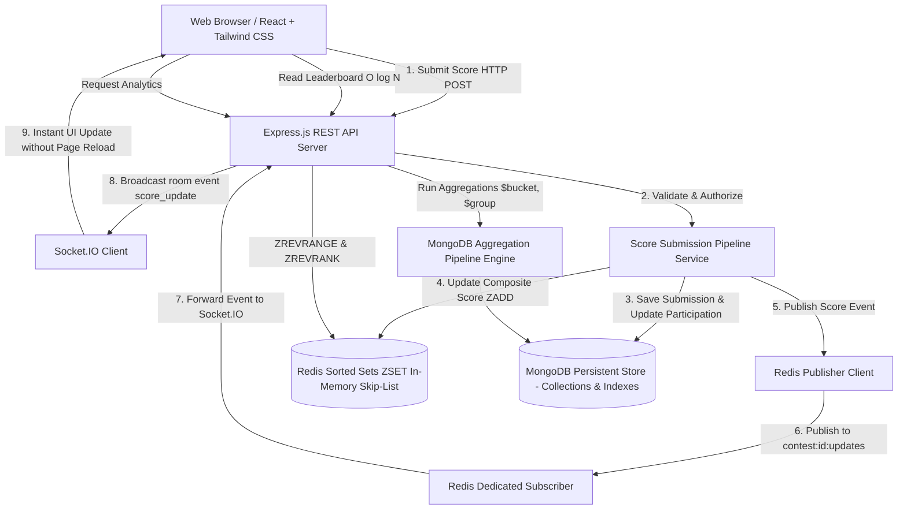
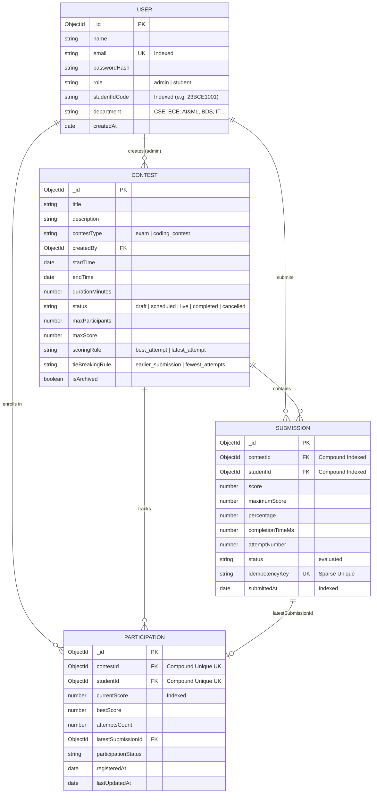
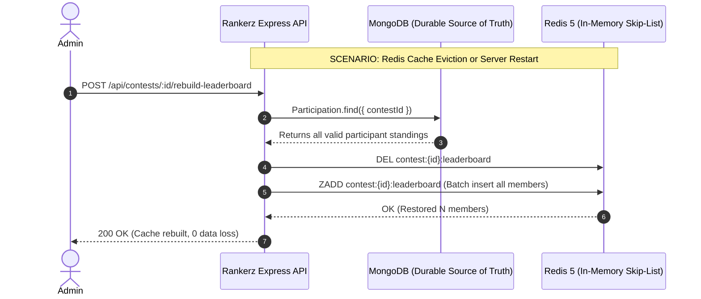

# RANKERZ — SYSTEM ARCHITECTURE & DATA MODEL SPECIFICATION
## VIT-AP University | School of Computer Science & Engineering (SCOPE)
### CSE3009 — NoSQL Databases | Course Instructor: Prof. Harapriya Kar
#### Project 5: Real-Time Contest & Exam Leaderboard Platform

---

## 1. High-Level System Architecture

The following diagram illustrates the complete end-to-end data flow of **Rankerz**, connecting client browsers, WebSocket streams, Express backend, Redis 5 in-memory engine, and MongoDB persistent document storage.

---

## 2. MongoDB Data Model (Entity Relationship Diagram)

---

## 3. Redis Key Namespacing & Data Structures

| Key Pattern | Redis Type | Internal Data Structure | Operations Used | Purpose in Rankerz |
| :--- | :--- | :--- | :--- | :--- |
| `contest:{contestId}:leaderboard` | **Sorted Set (ZSET)** | Skip-List + Hash Map | `ZADD`, `ZREVRANGE`, `ZREVRANK`, `ZSCORE`, `ZCARD`, `ZREM` | Ultra-fast ranking computation in $O(\log N)$ time complexity. |
| `contest:{contestId}:updates` | **Pub/Sub Channel** | Pub/Sub Message Bus | `PUBLISH`, `PSUBSCRIBE` (pattern: `contest:*:updates`) | Live event streaming between backend and Socket.IO. |

### Deterministic Tie-Breaking Score Formula
$$\text{CompositeScore} = \text{RawScore} + \left(1 - \frac{\text{CompletionTimeMs}}{100,000,000}\right) \times 0.001$$
- **Primary:** Score (Integer points).
- **Secondary:** Lower completion time receives higher fractional bonus ($0.00000001$ to $0.00099999$).
- Preserves clean integer points in display while ensuring deterministic ordering in Redis!

---

## 4. Two-Tier Consistency & Self-Healing Workflow

